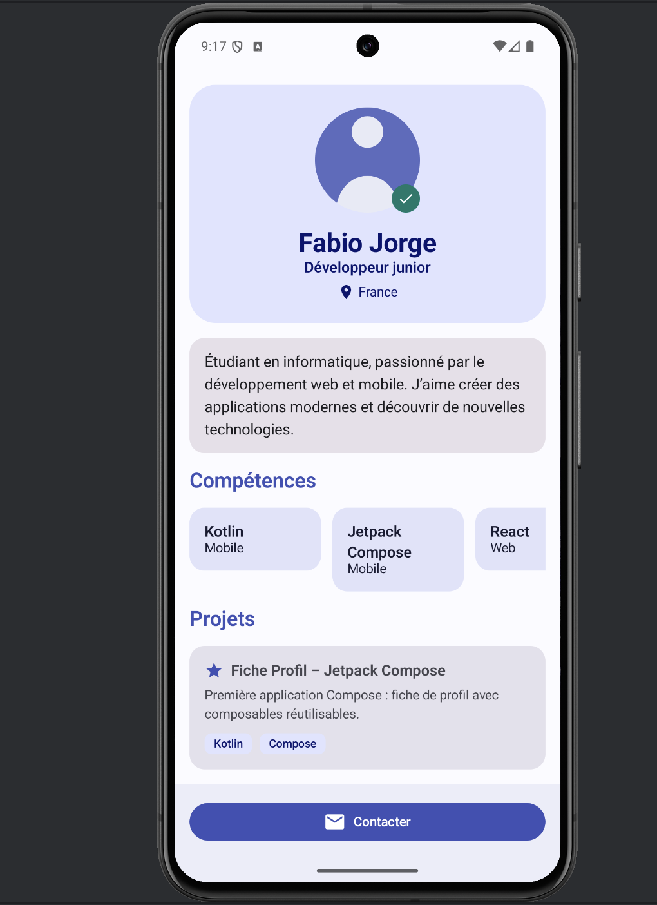
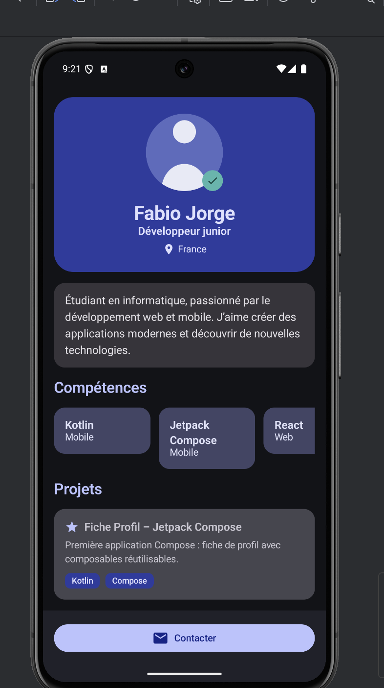

# Profil développeur — Compose UI (v2)

## Description

Application Android réalisée avec Kotlin et Jetpack Compose qui présente le profil d'un développeur junior : avatar avec badge de disponibilité, présentation, liste de compétences, liste de projets, zone de contact et bouton d'action « Contacter ».

Cette version 2 fait évoluer la [première version](https://github.com/Fabioj377/developer-profile-compose) (fiche simple) vers une interface plus complète, avec Material Design 3 et un thème clair / sombre. Toutes les données sont locales et écrites dans le code Kotlin (`data/SampleData.kt`).

## Captures d'écran

| Thème clair | Thème sombre |
|---|---|
|  |  |

## Composants Compose utilisés

- `Text` : nom, rôle, descriptions, titres de sections
- `Button` : action principale « Contacter »
- `Icon` : localisation, e-mail, badge, projets
- `Image` : avatar (drawable vectoriel placeholder)
- `Card` : bio, compétences, projets, contact
- `OutlinedTextField` en lecture seule : e-mail, localisation, disponibilité
- `Surface` : en-tête du profil, pastilles de technologies, barre d'action

## Layouts utilisés

- `Column` : structure verticale de l'écran et contenu des cartes
- `Row` : icône + texte (localisation, titre de projet), pastilles de technologies
- `Box` : avatar avec badge superposé en bas à droite
- `Spacer` : espacements entre éléments
- `Surface` : zone d'en-tête colorée et barre d'action cohérentes avec le thème

## Liste affichée avec LazyColumn / LazyRow

- **`LazyRow`** : les compétences, affichées horizontalement avec le composable réutilisable `SkillCard` (`items(profile.skills, key = { it.name })`).
- **`LazyColumn`** : tout le contenu défilant de l'écran, dont la liste des projets affichée avec `ProjectCard` (`items(profile.projects, key = { it.title })`). Les éléments ne sont composés que lorsqu'ils deviennent visibles, et la `key` aide Compose à identifier chaque élément.

## Choix de thème (Material Design 3)

- **`colorScheme`** : palette indigo / teal, définie en clair (`LightColors`) et en sombre (`DarkColors`). Le thème suit le réglage du système via `isSystemInDarkTheme()`. Les couleurs dynamiques (Material You) sont désactivées pour garder une identité visuelle stable.
- **`typography`** : styles personnalisés (`headlineMedium`, `titleLarge`, `titleMedium`, `bodyLarge`, `bodyMedium`, `labelMedium`) pour une hiérarchie claire.
- **`shapes`** : coins arrondis `small` (8 dp, pastilles), `medium` (16 dp, cartes) et `large` (28 dp, en-tête).
- Les composables utilisent uniquement `MaterialTheme.colorScheme / typography / shapes`, jamais de couleur en dur, donc le passage clair / sombre est automatique.

## Quelles notions du chapitre Compose UI ai-je réutilisées ?

J'ai réutilisé les composants fondamentaux (`Text`, `Button`, `Icon`, `Image`, `Card`, `OutlinedTextField`), les layouts (`Column`, `Row`, `Box`, `Spacer`, `Surface`), les listes modernes (`LazyColumn` et `LazyRow` avec des composables d'item réutilisables), Material Design 3 (`colorScheme`, `typography`, `shapes`) et le thème clair / sombre. Je garde aussi les bases de la v1 : composables avec paramètres, `Modifier`, callback `onClick` et `@Preview`.

## Previews

Des previews clair et sombre existent pour l'écran complet (`ProfileScreen.kt`) et pour l'en-tête (`ProfileHeader.kt`), plus une preview par carte.

## Lancer le projet

Ouvrir le dossier dans Android Studio, laisser Gradle se synchroniser, puis lancer sur un émulateur ou un appareil (minSdk 26).
